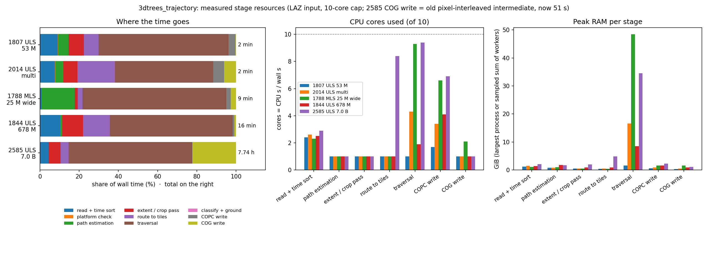

# 3dtrees_trajectory: what the tool does, when, and where the time goes

Status 20 Nov 2026, `main` after round 4. Scope of 1.0.0: moving lidar (ULS and MLS). TLS is v1.1.

## 1. What the tool does

The tool takes the point cloud of one ULS or MLS dataset and does two things.

1. **Trajectory.** It estimates where the sensor was, every 0.5 s, from the points alone.
2. **Occlusion.** It traces every laser pulse from the sensor through its returns. It then marks each 0.5 m voxel as
   seen, empty, hidden behind vegetation, or never reached.

**Inputs**

| Input | Required | Notes |
| --- | --- | --- |
| One collection of standardized LAS/LAZ files per dataset | yes | The output of the standardization tool. One job takes the whole collection. Files are read in parallel chunks, in scanner order. |
| Delivered trajectory (3Dtrees trajectory CSV) | no | If given, it is always used for occlusion instead of the estimate. |
| DTM raster | no | Ground for heights above ground. Default: the lowest hits per column. |

COPC input still works in the code, but it is not the production path.

**Outputs**

| Output | Content |
| --- | --- |
| Trajectory CSV (`3dtrees-trajectory/2`) | time, x, y, z per position, with method and quality in the header. Plus a GeoJSON line for the map. |
| JSON report | Method, quality, warnings, refusal reason, exit code, and time, CPU, RAM and scratch for every stage. |
| Occlusion COPC | One point per voxel. Class 1 filled, 2 empty, 3 occluded, 4 unobserved, plus hit, pass and hidden counts. |
| Occlusion COG | Occluded share per 1 m height band above ground, 0.5 m pixels. |

## 2. What happens when

The steps below follow `src/threedtrees_trajectory/cli.py:main`.

1. **Argument checks** (`cli.py:69-107`). Outputs must not overwrite inputs. The voxel size must be 0.05 to 10 m.
   At least one file is needed. A delivered trajectory is only accepted together with occlusion outputs. Any failure
   gives **exit 2**.
2. **Read and time-sort** (`cli.py:135-147`, `pulses.py`). Files are decoded in parallel chunks. GPS time must
   exist, be finite and vary (`pulses.py:436, 463, 482, 486`). If not: **exit 3** (`coverage.py:5`). Returns are
   paired into pulses per file. With no usable pulse: **exit 4** (`cli.py:146-147`).
3. **Platform check** (`cli.py:149-153`, `estimate.py:61`). A static scanner is recognised when one position
   explains all pulse lines within 5 cm, or when ground points pile up 15 times or more around one spot. TLS is
   refused with **exit 2**. The TLS code is on the branch `feat/tls-stations-v1.1`.
4. **Path estimation** (`cli.py:155-191`, `estimate.py`, `solve.py`). The method is chosen per file:
   - multi-return files: the pulse lines (first to last return) meet at the sensor. Method `lines`.
   - single-return files with a scan angle: cone fit on the scan angle. Method `scan_angle`.
   - mixed: lines, with gaps filled from scan angles per file. Method `lines_scan_angle`.
   - single returns **without** scan angle: no estimate is possible. **Exit 4** (`cli.py:158-161`), unless a
     delivered path is given.
5. **Quality label** (`output.py:51-60`). The median distance between pulse lines and the fitted path decides:
   - **good**: ≤ 0.1 m.
   - **rough**: 0.1 to 0.5 m, or any scan-angle position.
   - **unreliable**: > 0.5 m. The tool then retries with scan angles. Without a scan angle: **exit 4**
     (`cli.py:164-170`).
6. **Delivered path** (`cli.py:272-289`, `occlusion.py:130-145`). It always replaces the estimate for occlusion.
   The tool measures how far the pulse lines miss it. A median above 0.1 m is flagged in the report, but the path
   is still used. If the estimate fails but a delivered path exists, the job continues with the delivered path
   (`cli.py:172-176`).
7. **Occlusion grid** (`occlusion.py:438-487`). A first pass finds the extent, the ground and the canopy top. The
   grid is cropped to ground − 1 m … canopy top + 1 m (`occlusion.py:271-319`). Ground comes from the DTM if given,
   else from the lowest hits. If the grid fits the memory budget (default 16 GiB), it is **one tile**. Otherwise it
   is split into tiles with a buffer of up to 100 m (`occlusion.py:338-385`).
8. **Routing and traversal** (`occlusion.py:400-560`). Echoes are written to one spool per tile. Each tile is traced
   by OccPy's voxel traversal in its own worker process. Finished tiles are checkpointed, so a restarted job reuses
   them.
9. **Classes and products** (`occlusion.py:152-158, 600-720`). Class rule: filled where hit, else empty where a
   pulse passed, else occluded where hidden, else unobserved. Then the tool writes the COPC (untwine) and the COG.
10. **Occlusion failure** (`cli.py:209-222`). If occlusion fails, the trajectory is still kept. The error goes into
    the report and empty occlusion files are written.

### Exit codes

| Code | Meaning | Where |
| --- | --- | --- |
| 0 | Done | `cli.py:251` |
| 2 | Invalid arguments, unreadable input, out of memory, TLS refused, report not writable | `cli.py:65, 108, 153, 207, 241` |
| 3 | GPS time missing, constant or not finite | `coverage.py:5`, `pulses.py:436-486`, `estimate.py:115` |
| 4 | No path can be estimated (no pulses, single returns without scan angle, too few reliable positions) | `coverage.py:9`, `estimate.py:80, 101, 139, 141`, `cli.py:147, 160, 166` |

Every refusal still writes the JSON report with the reason.

## 3. Stage resources

Measured runs, 10-core cap. Numbers come from the jobs' own stage records (`figures/stages.csv`). 1807, 1844, 2014
and 2585 are round-2 runs on raw LAZ in scanner order. 1788 is a round-3 run on standardized LAZ. Standardization
keeps the point order (checked on 1915 and 2027), so raw-LAZ timings stand in for standardized ones. That is an
assumption for 1807, 1844, 2014 and 2585.

| Stage | What it does | 1807 ULS 53 M | 1844 ULS 678 M | 1788 MLS 25 M, wide | 2585 ULS 7.0 B |
| --- | --- | --- | --- | --- | --- |
| read + time sort | decode LAZ, pair returns, keep a sample for the path | 9 s · 2.4 cores · 1.2 GiB | 101 s · 2.5 · 1.4 GiB | 4 s · 2.3 · 1.1 GiB | 21 min · 2.9 · 2.1 GiB |
| path estimation | fit the sensor every 0.5 s | 5 s · 1.0 | 10 s · 1.0 | 88 s · 1.0 | 11 s · 1.0 |
| extent / crop pass | second pass: extent, ground, canopy top | 8 s · 1.0 | 105 s · 1.0 | 8 s · 1.0 | 28 min · 1.0 · 2.0 GiB |
| route to tiles | write echoes into tile spools | 8 s · 1.0 | 134 s · 1.0 · 32 GiB scratch | 12 s · 1.0 | 19 min · 8.4 · 356 GiB scratch |
| traversal | OccPy ray tracing per tile | 66 s · 1.0 · 1.6 GiB | 614 s · 1.9 · 8.5 GiB | 382 s · 9.3 · **48 GiB** | 4.9 h · 9.4 · 35 GiB · **568 GiB scratch** |
| COPC write | voxel COPC via untwine | 3 s | 9 s | 12 s | 38 s · 6.9 |
| COG write | height-band raster | 0.4 s | 9 s | 15 s | 1.7 h → **51 s since round 2** |
| **total** | | **2 min** | **16 min** | **9 min** | **7.7 h measured, ≈ 6 h with the COG fix** |

Format: wall time · CPU cores used (CPU s / wall s) · peak RAM (largest process, or the sampled sum of tile
workers) · scratch.

**Where the time and memory go**

- Traversal takes 60 to 80 % of the wall time in every run.
- Traversal runs on as many cores as there are tiles. Jobs that fit one tile (1807) trace on **1 core**. 1844 used
  2 tiles and got 1.9 cores.
- The extent/crop pass and path estimation always run on 1 core. Routing does too, except on jobs above
  2.1 billion points.
- Reading reaches only 2.4 to 2.9 cores.
- RAM is driven by the grid area, not by the point count. 1788 (25 M points, 1 km × 1 km × 640 m) needed 48 GiB,
  more than 2585 (35 GiB).
- Scratch is driven by duplicated echoes in tile buffers. On 2585, 7.0 billion points became 28.3 billion routed
  echoes (4×), and peak scratch was 568 GiB.

## 4. Where we can speed up

Ranked by expected gain on typical jobs (≤ 750 M points). **Measured** = taken from a run. **Estimated** = my
projection, not run yet.

| # | Change | Expected gain | Effort / risk to identical results |
| --- | --- | --- | --- |
| 1 | **Always split traversal into at least as many tiles as slots** (for example 10 time or space strips), even when the grid fits one tile. Today the tiling decision only looks at memory (`occlusion.py:342`). | Traversal 1 → ~8 cores. 1807 66 s → ~10 s, 1844 614 s → ~90 s. Total 1807 2 → ~1 min, 1844 16 → ~8 min. *Estimated.* Traversal already scales to 9.3 to 9.4 cores where tiles exist (1788, 2585, *measured*). | Low effort, the tile code exists. Counts add up across tiles, but buffer edges change a few voxels: 8 vs 9 tiles on 2014 changed 11 COG values (*measured*, round 2). Not byte-identical to one tile. |
| 2 | **Fold the extent/crop pass into the first read, or run it in parallel over the spool.** Extent, lowest and highest hit per column are min/max and counts, so order does not matter. | 2585 −28 min of 6 h; 1844 −105 s of 16 min. *Estimated from measured stage times.* | Medium effort. Byte-identical results expected, because min/max are exact. |
| 3 | **Parallel routing for all jobs.** Today only jobs above 2.1 B echoes route in parallel (`occlusion.py:409-411`). | 1844 134 s → ~20 s. 2585 already uses 8.4 cores. *Estimated.* | Low effort. Spool contents are the same, but the order within a spool can change. Traversal counts are order-independent, so results should be identical. Needs a check. |
| 4 | **Smaller tile buffer for ULS.** Buffers up to 100 m make every echo land in about 4 tiles on 2585. A buffer sized from the flight height and maximum scan angle (for example 40 m) cuts the duplicates. | 2585: routing, traversal and scratch scale with routed echoes. Maybe −30 to −50 % traversal and scratch. *Estimated, needs a test.* | Medium effort. Results change at tile edges when pulses come from outside the buffer. Needs an equality test against today's output. |
| 5 | **Parallel path estimation** (independent 0.5 s windows). | 1788 88 s → ~12 s. Small for multi-return jobs (5 to 11 s). *Estimated.* | Low effort. Byte-identical if windows are merged in order. |
| 6 | **More decode parallelism** (several files at once, per-file sort in workers). | Read reaches 2.4 to 2.9 cores today. 2585 21 min → ~8 min. *Estimated.* | Medium effort. Identical if the per-file order is kept. |
| — | COG band-interleaved write (done in round 2) | 2585 6,204 s → 51 s (*measured*) | Done |

**Memory**

- **Wide grids** (MLS, large areas): the grid, not the point count, sets RAM. Options:
  - Fewer parallel tile workers when the grid is wide. This already happens through each worker's memory
    reservation.
  - Tile by the vegetation envelope only, not the whole bounding box.
  - An option for 1 m voxels on very large or very wide jobs: 8× less grid memory, coarser product.
- **Scratch:** a smaller buffer (#4) and the compressed spools (already on above 2.1 B echoes) cut it. Enabling
  compression on all jobs costs CPU and saves about 70 % of spool space (*measured* on 2585 samples).

**Resource request for Galaxy (proposal, 10 cores)**

| Points | RAM | Scratch | Wall limit |
| --- | --- | --- | --- |
| ≤ 75 M | 32 GiB | 16 GiB | 1 h |
| 75–750 M | 64 GiB | 96 GiB | 2 h |
| 750 M–2.1 B | 96 GiB | 256 GiB | 5 h (*estimated*) |
| 2.1–7.1 B | 140 GiB | 750 GiB | 10 h (*estimated*; 2585 not yet run at 140 GiB) |
| Wide grid (like 1788) | ≥ 96 GiB | from grid size | from grid size |

## 5. Limits and v1.1

- **TLS:** occlusion from provided scan positions is on branch `feat/tls-stations-v1.1`. Still open there:
  - merged clouds without scan IDs, such as 3950 (station-visibility mode);
  - a same-grid test for 2789.
- **SLAM paths** (GeoSLAM `_traj.txt`): the upload accepts them. The tool can use them only if the path time
  matches the points' GPS time. This is not yet checked on real data.
- **Livox with constant GPS time** (3516): refused, exit 3. The vendor keyframes match the points, but using them
  needs a decision.
- **Supplementary fallback:** trajectories that the upload or this tool cannot use should be kept as supplementary
  data on the dataset. They will be added when the format is supported.
- **Coverage** (production screen, 20 Nov):
  - 1,034 MLS/ULS datasets have multiple returns.
  - 57 are single-return with a scan angle.
  - 772 are refused: 408 single-return without scan angle (mostly GeoSLAM MLS), 364 with missing or constant
    GPS time.
  - 513 are unknown (no standardization metadata yet).
