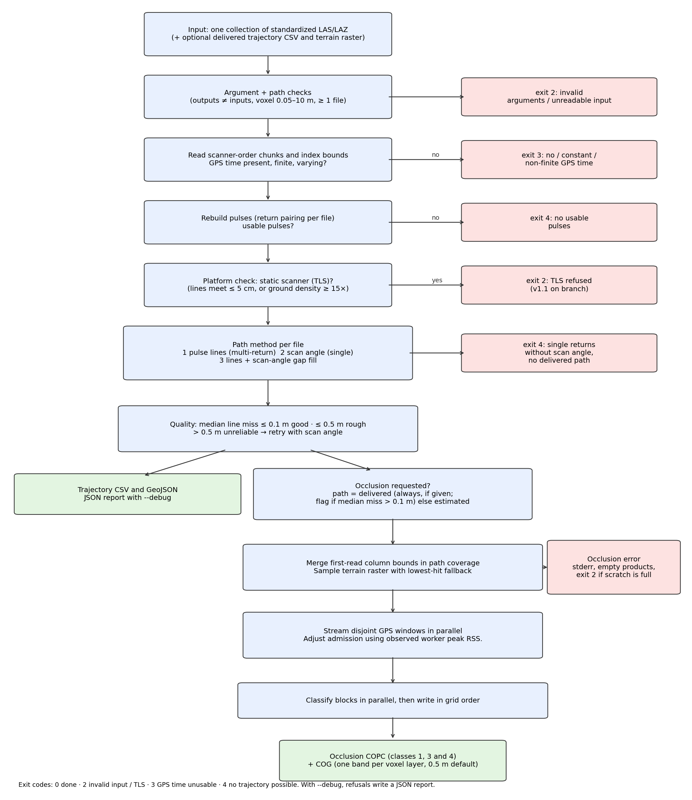
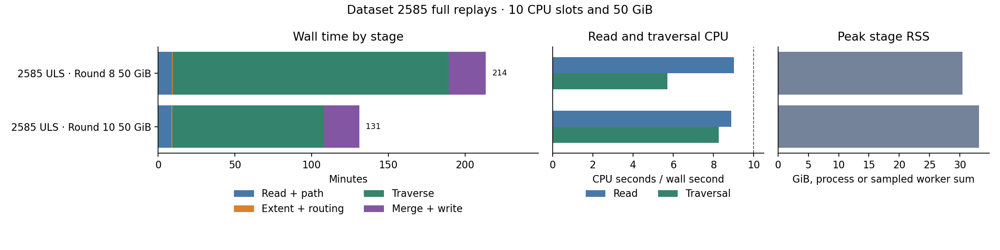

# 3dtrees_trajectory: what the tool does, when, and where the time goes

Status 23 Nov 2026, `main` after round 9. Version 1.0.0 covers moving lidar (ULS and MLS). TLS is v1.1.

## 1. What the tool does

The tool takes the point cloud of one ULS or MLS dataset and does two things.

1. **Trajectory.** It estimates where the sensor was, every 0.5 s, from the points alone.
2. **Occlusion.** It traces every laser pulse from the sensor through its returns. It then marks each voxel as
   filled, empty, occluded, or unobserved. Voxel size defaults to 0.5 m.

**Inputs**

| Input | Required | Notes |
| --- | --- | --- |
| One collection of standardized LAS/LAZ files per dataset | yes | The output of the standardization tool. One job takes the whole collection. Files are read in parallel chunks, in scanner order. |
| Delivered trajectory (3Dtrees trajectory CSV) | no | If given, it is always used for occlusion instead of the estimate. |
| Terrain raster (`--dtm PATH`) | no | Supports the raster tool's 1 m `<prefix>_dtm.tif`. The cloud and raster must declare the same CRS. |

A merged COPC is accepted for trajectory estimation. Occlusion requires the scanner-order LAS/LAZ collection.

**Outputs**

| Output | Content |
| --- | --- |
| Trajectory CSV (`3dtrees-trajectory/2`) | time, x, y, z per position, with method, quality, source and any warnings in the header. If the job also checks a delivered path, the header carries its miss flag. A companion GeoJSON provides the map layer. |
| Occlusion COPC | One point per filled (1), occluded (3), or unobserved (4) voxel from ground through canopy top, with hit, pass and hidden counts. |
| Occlusion COG | Occluded share per voxel layer above ground, followed by the unobserved share for the column. Pixels and height bands default to 0.5 m and follow `--voxel`. The `OCCLUSION_BAND_M` tag records the height step. |

The COG dataset tags and the COPC's `3dtrees` extended variable length record (record ID 1) carry
`OCCLUSION_PATH_METHOD`, `OCCLUSION_QUALITY`, and `OCCLUSION_TRAJECTORY`. When present,
`OCCLUSION_WARNINGS` is a JSON array of warning strings stored as a tag value.
`OCCLUSION_DELIVERED_MISS_FLAG` is `true`, `false`, or `unavailable` for a delivered path and
corresponds to `# delivered_path_miss_flag:` in an accompanying CSV. CSV warnings use repeatable
`# warning:` lines.

The COG and COPC also carry `OCCLUSION_GROUND` (`dtm`, `lowest_hit`, or `dtm+lowest_hit`). Mixed
runs carry the DTM and fallback fractions of the XY grid as `OCCLUSION_GROUND_DTM_SHARE` and
`OCCLUSION_GROUND_LOWEST_HIT_SHARE`.

### Debug report

`--debug` writes a JSON report with method, quality, warnings, flags, refusal reason, exit code,
COG height-band step (`occlusion.cog_band_step_m`), and time, CPU, RAM and scratch for every stage.
It records the ground source in `occlusion.ground` and the XY column fractions in
`occlusion.ground_column_shares` when given a DTM.
The default path is `<csv-stem>.report.json` beside the CSV. Set `--debug --report PATH` to choose
another path or to request a report for an occlusion-only run. `--report PATH` alone exits 2.
The Galaxy wrapper lives outside this repository and must collect a JSON output only when debug is enabled.

## 2. What happens when

The steps below follow `src/threedtrees_trajectory/cli.py:main`.

1. **Argument checks** (`cli.py`). Outputs must not overwrite inputs. The voxel size must be 0.05 to 10 m.
   At least one file is needed. A delivered trajectory or DTM requires both occlusion outputs. An unreadable
   DTM or missing or mismatched CRS gives **exit 2**.
2. **Read and time-sort** (`cli.py`, `pulses.py`). Large files use independently decoded, ordered record ranges.
   For compressed LAS 1.4 point formats 6–10, this pass asks lazrs for the XY/returns/scanner-channel base
   layer, Z, GPS time, point source ID and scan angle. Formats 0–5 use full decoding. GPS time must
   exist, be finite and vary (`pulses.py`). If not: **exit 3** (`coverage.py`). Returns are
   paired into pulses per file. With no usable pulse: **exit 4** (`cli.py`).
3. **Platform check** (`cli.py`, `estimate.py`). A static scanner is recognised when one position
   explains all pulse lines within 5 cm, or when ground points pile up 15 times or more around one spot. TLS is
   refused with **exit 2**. The TLS code is on the branch `feat/tls-stations-v1.1`.
4. **Path estimation** (`cli.py`, `estimate.py`, `solve.py`). The method is chosen per file, with independent fits started concurrently:
   - multi-return files: the pulse lines (first to last return) meet at the sensor. Method `lines`.
   - single-return files with a scan angle: cone fit on the scan angle. Method `scan_angle`.
   - mixed: lines, with gaps filled from scan angles per file. Method `lines_scan_angle`.
   - single returns **without** scan angle: no estimate is possible. **Exit 4** (`cli.py`), unless a
     delivered path is given.
5. **Quality label** (`output.py`). The median distance between pulse lines and the fitted path decides:
   - **good**: ≤ 0.1 m.
   - **rough**: 0.1 to 0.5 m, or any scan-angle position.
   - **unreliable**: > 0.5 m. The tool then retries with scan angles. Without a scan angle: **exit 4**
     (`cli.py`).
6. **Delivered path** (`cli.py`, `occlusion.py`). It always replaces the estimate for occlusion.
   The tool measures how far the pulse lines miss it and flags a median above 0.1 m in the products and optional
   debug report. Occlusion uses the delivered path even when the estimate fails (`cli.py`).
7. **Occlusion grid** (`window_input.py`, `occlusion.py`). During the first read, indexed record ranges store time
   bounds and column extrema. The ground surface takes the raster cell containing each voxel column centre
   (nearest neighbour). Without a valid raster sample, ground comes from the lowest hit in that column.
   For this estimate, empty columns take their nearest ground estimate and ground spikes take the local median.
   The highest hits within path coverage give canopy height.
   The final vertical grid spans ground minus 1 m through canopy top plus 1 m, within the point extent.
8. **Traversal** (`time_windows.py`, `ray_walk.cpp`). Workers seek the relevant LAS/LAZ ranges, rebuild whole
   pulses and trace them in disjoint GPS windows. Separated returns are sorted by index and paired in bounded
   batches that keep equal time, point source and channel together. The window planner uses the available slots and splits
   further in time if needed. The scheduler starts each worker with a reservation based on the window's echo
   count, count voxels and columns. It scales the planning estimate for later workers by the highest observed
   RSS-to-estimate ratio, adds 25% and 256 MiB, and checks cgroup headroom before admitting workers.
   Clean file pages can be reclaimed. Dirty and writeback pages count against headroom.
   On suspected memory failure, it drains active workers before retrying the affected window alone
   with a larger reservation. Completed count files can be reused after an interruption.
   The reread needs point source ID for pulse grouping and clock repair, so it skips scan angle.
   Unrepaired path-boundary rereads need just the base layer, Z and GPS time.
9. **Classify voxels + write products** (`occlusion.py`). Workers sum hit, pass and hidden counts and classify each
   block independently. The writer consumes completed blocks in grid order. A hit makes a filled
   voxel, a pass makes an empty voxel, and hidden-only makes an occluded voxel. Keep an unobserved class
   for voxels with zero coverage. Write voxel records to COPC and an occluded share to each COG band.
   With voxel size `s`, band `k` covers `[k·s, (k+1)·s)` metres above ground.
10. **Occlusion failure** (`cli.py`). Print the error to stderr and publish zero-byte occlusion files.
    Ordinary traversal errors after a successful trajectory estimate retain it with a warning in its CSV header.
    Exhausted checkpoint storage is a job error with exit code 2.

### Exit codes

| Code | Meaning | Where |
| --- | --- | --- |
| 0 | Done | `cli.py` |
| 2 | Invalid arguments, unreadable input, out of memory, checkpoint storage exhausted, TLS refused, requested debug report not writable | `cli.py` |
| 3 | GPS time missing, constant or not finite | `coverage.py`, `pulses.py`, `estimate.py` |
| 4 | No path can be estimated (no pulses, single returns without scan angle, too few reliable positions) | `coverage.py`, `estimate.py`, `cli.py` |

Refusals print a reason to stderr and write zero-byte products at safe destinations. The debug report also
records the reason when requested. Exit 3, exit 4 and delivered-path check errors ask the uploader to retain the
path as supplementary data.

## 3. Stage resources

Round 10 control replays used the pinned image, ten CPU slots, and a 50 GiB cap. Each pair compares wall
times from one run at `38ff410` and one at round 10 with lowest-hit ground.

| Dataset | Whole job (s) | Path (s) | Traversal (s) | Classify and write (s) | COG (s) |
| --- | ---: | ---: | ---: | ---: | ---: |
| 1807 | 28.7 → 24.6 | 1.0 → 1.1 | 15.9 → 12.6 | 1.3 → 0.3 | 0.8 → 0.7 |
| 1844 | 311.3 → 228.0 | 5.6 → 5.1 | 215.7 → 167.5 | 10.6 → 1.8 | 10.1 → 6.6 |
| 2014 | 67.4 → 50.2 | 1.0 → 1.0 | 27.6 → 22.0 | 11.0 → 2.1 | 9.4 → 6.4 |
| 1788 | 236.9 → 93.7 | 89.3 → 17.9 | 48.9 → 23.2 | 45.5 → 8.0 | 28.3 → 19.3 |

The 1788 scan-angle fits use separate processes and merge in time order. The optimized ray walker reuses
the active column and specializes single-return pulses. In a one-core benchmark of 1.8 million synthetic
rays it ran in 4.03 s, down from 5.13 s, with identical counts.

Terrain controls use the round-9 reference rasters for 1807 and 2014 and locally generated 1 m
lowest-return fixtures for 1844 and 1788. Each comparison uses the same raster for both tool versions.

The round-7 baseline (`6e2410a`) and round 8 used the same local scanner-order LAZ inputs and ten
CPU slots per job within a shared 140 GiB scope. Datasets 1807, 1844 and 2014 are ULS and 1788
is the standardized MLS replay. The runs used separate CPU sets on the same host. Timing comes
from one replay per dataset and version.

| Dataset | Wall (s) | Mean cores | Peak RSS (GiB) | Peak workers | Peak reservations (GiB) | Read (s) |
| --- | ---: | ---: | ---: | ---: | ---: | ---: |
| 1807 | 25.1 → 24.5 | 5.12 → 5.10 | 4.09 → 3.80 | 10 → 10 | 25.95 → 25.95 | 5.3 → 4.8 |
| 1844 | 200.4 → 199.3 | 7.30 → 7.20 | 5.86 → 5.86 | 10 → 10 | 96.09 → 96.09 | 37.0 → 35.3 |
| 2014 | 65.0 → 65.8 | 4.91 → 4.81 | 5.08 → 5.06 | 10 → 10 | 29.53 → 29.53 | 7.6 → 7.2 |
| 1788 | 242.1 → 238.6 | 3.21 → 3.31 | 8.86 → 8.90 | 10 → 10 | 32.67 → 32.67 | 4.9 → 4.8 |

Each pair reads from round 7 to round 8. Mean cores are CPU seconds per wall second. Peak worker
reservations reached the same values because all ten windows fit at startup on these four inputs.
Peak RSS is the larger of the sampled worker-inclusive aggregate and the highest single-process RSS.

<!-- stages:start -->
| Round 8 stage | 1807 ULS | 1844 ULS | 2014 ULS | 1788 MLS |
| --- | ---: | ---: | ---: | ---: |
| Read, reconstruct pulses and index source | 4.8 s / 6.8 cores | 35.3 s / 9.1 cores | 7.2 s / 5.6 cores | 4.8 s / 3.4 cores |
| Path fitting | 1.0 s / 5.7 cores | 5.3 s / 3.5 cores | 1.0 s / 6.2 cores | 92.6 s / 2.5 cores |
| Extent and crop | 0.2 s / 1.0 cores | 0.8 s / 1.0 cores | 1.6 s / 1.0 cores | 4.8 s / 1.0 cores |
| Plan GPS windows | 0.0 s / 1.0 cores | 0.2 s / 1.0 cores | 0.1 s / 1.0 cores | 0.1 s / 1.0 cores |
| Rebuild and trace pulses | 11.9 s / 6.5 cores | 125.9 s / 8.1 cores | 26.2 s / 8.0 cores | 45.6 s / 7.6 cores |
| Classify voxels + write products | 1.4 s / 1.0 cores | 10.5 s / 1.0 cores | 11.2 s / 1.0 cores | 47.4 s / 1.0 cores |
| Write voxel COPC | 3.6 s / 1.7 cores | 9.8 s / 3.8 cores | 8.0 s / 3.3 cores | 12.0 s / 6.4 cores |
| Write height-band COG | 0.9 s / 1.0 cores | 9.6 s / 2.1 cores | 9.2 s / 2.1 cores | 28.6 s / 2.3 cores |
<!-- stages:end -->

CPU use is CPU seconds divided by wall seconds. Traversal includes source seeks, decoding, pulse grouping,
the ray walk and checkpoint writes. The first read reduces per-column minima and maxima. Once the path is
known, preparation decodes only indexed ranges that straddle the accepted time limits. The measurements
separate preparation from the streaming traversal's own source reads. Extent preparation decoded one
200,000-record boundary range on 1807 and zero records on 1844, 2014 and 1788.

### Round-8 product equality

| Dataset | CSV | GeoJSON | COG tiles | Decoded COPC records |
| --- | --- | --- | --- | ---: |
| 1807 | Exact | Exact | Exact | 1,657,932 exact |
| 1844 | Exact | Exact | Exact | 10,525,300 exact |
| 2014 | Exact | Exact | Exact | 7,977,880 exact |
| 1788 | Exact | Exact | Exact | 23,932,359 exact |

The complete CSV, GeoJSON and COG files match byte for byte, including every COG tile and overview. COPC
comparison hashes the complete decoded records in voxel order and checks scales, offsets and product
metadata. Untwine can place the same records differently in the compressed file.

### Round 9 terrain raster validation

The two 1 m DTMs came from the local raster 1.0.0 image at `069903f`. Its preflight required an
instance dimension on these acquisitions, so its input copies carried a zero-filled `PredInstance`.
The trajectory replays used the original scanner-order inputs and a 0.5 m voxel size.

| Dataset | CSV | GeoJSON | COG | COPC file | Decoded COPC records | Baseline vs repeat COPC file |
| --- | --- | --- | --- | --- | ---: | --- |
| 1807 | Exact | Exact | Exact | Different | 1,657,932 exact | Different |
| 2014 | Exact | Exact | Exact | Different | 7,977,880 exact | Different |

Independent runs of `bac53e7` also produced different compressed COPC bytes. The input LAS
bytes passed to Untwine, the decoded voxel records in coordinate order, the CRS and the product
tags matched in all three no-DTM runs for each dataset.

| Dataset | DTM XY coverage | Median absolute ground difference (m) | Filled | Empty | Occluded | Unobserved |
| --- | ---: | ---: | ---: | ---: | ---: | ---: |
| 1807 | 93.28% | 0.219 | 1,445,111 → 1,392,804 | 2,526,490 → 2,572,952 | 212,799 → 561,489 | 22 → 35 |
| 2014 | 64.92% | 0.315 | 6,951,441 → 6,381,625 | 11,182,745 → 11,515,558 | 1,001,850 → 2,298,990 | 24,589 → 38,841 |

Ground differences compare a raster sample with the lowest-hit estimate in every column with a
valid raster sample, including columns where the lowest-hit estimate used a neighbour.
Counts and COG shares are shown as lowest hits → DTM with fallback.

| Dataset | Pooled occluded share | 0–0.5 m | 0.5–1 m | 1–1.5 m | Mean unobserved-column band |
| --- | ---: | ---: | ---: | ---: | ---: |
| 1807 | 5.09% → 12.40% | 7.46% → 38.69% | 9.92% → 42.23% | 12.93% → 39.97% | 0.0003% → 0.0006% |
| 2014 | 5.24% → 11.38% | 5.31% → 20.23% | 5.92% → 20.37% | 8.08% → 19.73% | 0.0746% → 0.1159% |

Both runs with a DTM retained byte-identical trajectory CSV and GeoJSON.

### Selective LAZ decoding

The table compares all layers with selective decoding on local LAS 1.4 copies. Each value is the
median of three read-only sweeps using ten CPU slots and one million records per batch. Required
fields have the same byte digest in every sweep. The PF 8 conversion sets NIR to zero because
the PF 3 source has no NIR channel.

| LAS 1.4 copy | Points | Read wall (s) | Read CPU (s) | Peak RSS (MiB) |
| --- | ---: | ---: | ---: | ---: |
| 1807 PF 7 | 52,718,335 | 4.72 → 3.49 | 25.28 → 18.81 | 163.4 → 160.6 |
| 2014 PF 8 | 52,650,235 | 4.23 → 3.51 | 21.63 → 16.95 | 165.1 → 163.0 |

### COG height-band comparison

Each row compares the round-5 1 m COG with the round-6 0.5 m COG. Band counts include the final
`unobserved_column` band. Write time measures COG creation from the intermediate raster. The replays ran
on separate days.

| Dataset | COG bands | COG size (MiB) | COG write (s) |
| --- | ---: | ---: | ---: |
| 1807 | 37 → 72 | 0.63 → 0.96 | 0.46 → 0.84 |
| 2014 | 45 → 89 | 6.69 → 10.17 | 4.03 → 9.30 |
| 1844 | 49 → 97 | 4.37 → 6.73 | 4.05 → 9.72 |
| 1788 | 71 → 140 | 30.31 → 46.80 | 18.05 → 28.43 |

The decoded COPC records match for all four datasets when sorted by voxel centre. At base resolution,
combining adjacent 0.5 m bands over observed voxels reproduces the 1 m raster values. The
`unobserved_column` values match exactly.

## 4. Streaming evaluation and speed-up

The comparisons in this section use the round-5 measurements.

<!-- comparison:start -->
| Dataset | Spatial spool wall / CPU | GPS windows wall / CPU | Peak RSS, GiB | Peak scratch, GiB | Peak RSS per window, GiB |
| --- | ---: | ---: | ---: | ---: | ---: |
| 1807 | 103 s / 1.2 cores | 22 s / 5.5 cores | 1.57 → 3.83 | 2.17 → 0.49 | 0.12 |
| 1844 | 1061 s / 1.7 cores | 208 s / 6.9 cores | 8.69 → 5.84 | 32.49 → 3.25 | 0.31 |
| 2014 | 145 s / 2.8 cores | 57 s / 5.3 cores | 16.81 → 4.66 | 6.48 → 2.36 | 0.49 |
| 1788 | 597 s / 6.6 cores | 223 s / 3.3 cores | 45.66 → 8.87 | 28.96 → 6.32 | 0.48 |
<!-- comparison:end -->

The RSS column shows the maximum of the largest process and the sampled sum of active worker RSS. Scratch
uses samples of allocated blocks. Spatial-spool scratch for the raw replays comes from archived matching-input
runs. File cache is accounted for separately by the capped job scope.

### Product equality

| Dataset | Reference | Filled / empty / occluded / unobserved | COG values differing | COPC voxel centres differing | COPC class or count fields differing |
| --- | --- | --- | ---: | ---: | ---: |
| 1807 | Round 4, one whole grid | 1,445,111 / 2,526,490 / 212,799 / 22 | 0 | 0 | 0 |
| 2014 | Round 4, one whole grid, 64 GiB planning budget | 6,951,441 / 11,182,745 / 1,001,850 / 24,589 | 0 | 0 | 0 |

The trajectory CSV, GeoJSON and COG bytes agree for both controls. The complete decoded COPC point
records also agree byte for byte when sorted by voxel centre. The compressed files differ after Untwine
indexing.

| Dataset | Round-4 spool reference | Filled / empty / occluded / unobserved change | COG cells differing | Max COG difference | Old-only / new-only COPC centres |
| --- | --- | --- | ---: | ---: | ---: |
| 1807 | 1 grid | 0 / 0 / 0 / 0 | 0 | 0 | 0 / 0 |
| 1844 | 2 spatial tiles | −1 / +1 / 0 / 0 | 0 | 0 | 1 / 0 |
| 2014 | 8 spatial tiles | 0 / 0 / 0 / 0 | 11 | 1.0 | 6 / 6 |

The prior tile cores were traced with local grid boundaries and buffered inputs. The full-grid controls
isolate equivalence from that clipping. The 1844 difference is one previously filled centre at
(366537.75, 5977455.25, 9.25). The 2014 COG differences against spatial tiles disappear when the
reference uses the same round-4 whole grid.

### GPS windows on a wide strip

The initial rectangular window grids exceeded the budget on 2014 and 1788. The compiled walker retains the
whole-grid entry and lattice calculations. Each worker stores counts only for the ground-to-canopy layers
in its indexed reach. The 1788 grid spans 2,000 × 2,000 × 1,278 voxels. Its widest planned windows each
reserved 67.1 million count cells and finished within the 16 GiB per-window budget. The largest
scanner-order ULS strip checked in local staging was 2014 at 658 × 740 m. Its per-window process
RSS and the 1788 measurements are in the comparison table. The planner bisects a window when
its estimated bytes or echo count exceed its budget.

Use direct GPS-window streaming for scanner-order LAS/LAZ. Pulse grouping runs inside each worker for all
job sizes. The output merge adds counts blockwise before assigning classes. Interleaved GPS times can make
several workers decode the same compressed record range. Half-open time bands assign each retained echo to
one window. The 1788 traversal decoded 41.1 million records for 24.7 million echoes traced.

### Read parallelism

<!-- read:start -->
| Dataset | Spatial-spool first read | GPS-window first read | Record-range workers |
| --- | ---: | ---: | ---: |
| 1807 | 9.6 s / 2.3 cores | 4.7 s / 6.5 cores | 10 |
| 1844 | 102.3 s / 2.5 cores | 38.5 s / 8.2 cores | 10 |
| 2014 | 11.1 s / 2.5 cores | 7.6 s / 5.1 cores | 10 |
| 1788 | 4.6 s / 2.2 cores | 4.6 s / 3.3 cores | 5 |
<!-- read:end -->

The old path used a native parallel LAZ decoder inside a sequential Python batch pipeline. The 2014
control spent 3.27 s decoding at 6.1 cores, 3.50 s reconstructing sampled pulses and 1.65 s writing
the source echo spool. Each batch waited for those operations before the next decode. Independent
record-range workers now decode, reconstruct and index their own ranges. The reader joins their pulse
columns in scanner order and carries the equal-time tail across range boundaries. The read figures
include worker startup, result collection and the ordered merge. The averages reached 8.2 cores
on 1844 and 5.1 on 2014 with ten workers.

### Dataset 2585 at 50 GiB

The 50 GiB replays used the same 25 local scanner-order LAS 1.2 PF 3 files (7,044,924,732 input points),
ten CPU slots, and no swap. Round 10 used `--grid-memory-gib 8`. Mean cores, peak RSS and scratch each
read from round 8 to round 10. RSS uses the greater of the sampled worker-inclusive sum and the largest
process. Scratch uses allocated blocks.

| Stage | Round 8 wall | Round 10 wall | Mean cores | Peak RSS (GiB) | Allocated scratch (GiB) |
| --- | ---: | ---: | ---: | ---: | ---: |
| Read, reconstruct pulses and index source | 8:39 | 8:23 | 9.01 → 8.89 | 16.08 → 15.29 | — → — |
| Platform check | 0:00 | 0:00 | 1.00 → 1.00 | 12.38 → 12.36 | — → — |
| Path fitting | 0:24 | 0:16 | 1.62 → 1.62 | 12.39 → 12.37 | — → — |
| Extent and crop | 0:16 | 0:16 | 1.00 → 1.00 | 11.86 → 11.80 | — → — |
| Plan GPS windows | 0:15 | 0:26 | 1.00 → 1.00 | 11.93 → 11.94 | — → — |
| Rebuild and trace pulses | 2:59:48 | 1:38:40 | 5.71 → 8.26 | 30.46 → 32.11 | 26.24 → 32.78 |
| Classify voxels and write intermediates | 20:40 | 20:48 | 1.00 → 2.16 | 16.17 → 21.77 | 30.05 → 38.54 |
| Write voxel COPC | 0:33 | 0:32 | 8.39 → 8.55 | 14.03 → 33.19 | 41.69 → 50.18 |
| Write height-band COG | 2:57 | 1:37 | 1.65 → 2.03 | 13.65 → 18.39 | 41.69 → 50.19 |
| Whole job | 3:33:44 | 2:11:02 | 5.31 → 7.20 | 30.46 → 33.19 | 41.69 → 50.19 |

Round 10 completed 143 GPS windows. Peak concurrency rose from seven to ten workers. Mean traversal CPU
rose from 5.71 to 8.26 cores. Peak reservations were 34.35 GiB in round 10 and 34.51 GiB in round 8.
Median and maximum worker RSS were 1.36 and 3.08 GiB in round 10. Cgroup memory peaked at 50.00 GiB
including file cache. The run recorded zero OOM kills and zero isolated retries.

Round 8 reserved substantially more than the measured RSS for the largest windows. About 1.5% of its
reads repeated records at window boundaries. Round 10 reduces retained fragment arrays, accounts for dirty
file pages, and uses a lower per-window planning ceiling to improve admission.

The CSV and GeoJSON matched round 8 byte for byte. COG pixels and stored tags matched, as did all
decoded COPC records sorted by voxel centre. Untwine randomly samples COPC overview levels during
packaging, so equivalent records can produce different compressed bytes.
[Untwine 1.5.1 sampling implementation](https://github.com/hobuinc/untwine/blob/1.5.1/bu/Processor.cpp#L99-L126)

The first merge took 20:48. A tile can overlap more windows than the 32-entry cache can hold, causing the
same column offsets to be rebuilt for successive tiles. The new cache retains the layouts and virtual
mappings when cgroup headroom and the file-descriptor limit allow it. The checkpoint replay reused
143 completed windows under the same 50 GiB cap. It classified and wrote the intermediates in 1:13.
Substituting that measured stage into the full run gives an estimated 1:51:27 from scratch. The resumed
merge's process RSS peaked at 62.13 GiB including mapped count files. The resumed cgroup reached 50 GiB
with zero OOM kills.

The stopped 50 GiB run processed 2.68 billion echoes in 3 h 24 min, compared with 1 h 35 min in round 8
and under 44 min in round 10. The round-2 spatial-tile replay took 7 h 46 min under a 190 GiB cap. The
full 50 GiB replays used the raw acquisition. A standardized 2585 replay is required to validate the
Galaxy estimate for that acquisition.

**Resource request for Galaxy (proposal, 10 cores)**

| Points | RAM | Scratch | Wall limit |
| --- | --- | --- | --- |
| ≤ 75 M | 32 GiB | 16 GiB | 1 h |
| 75–750 M | 64 GiB | 96 GiB | 2 h |
| 750 M–2.1 B | 96 GiB | 256 GiB | 5 h, estimated |
| 2.1–7.1 B | 96 GiB | 256 GiB | 6 h, estimated |

For wide grids, also size for the ground-to-canopy count cells, merge block depth and raster band count.

## 5. Limits and v1.1

- **TLS:** occlusion from provided scan positions is on branch `feat/tls-stations-v1.1`. Still open there:
  - merged clouds without scan IDs, such as 3950 (station-visibility mode);
  - a same-grid test for 2789.
- **SLAM paths** (GeoSLAM `_traj.txt`): the upload accepts them. The tool can use them only if the path time
  matches the points' GPS time. This is not yet checked on real data.
- **Livox with constant GPS time** (3516): refused, exit 3. The vendor keyframes match the points, but using them
  needs a decision.
- **Supplementary fallback:** trajectories that the upload or this tool cannot use should be kept as supplementary
  data on the dataset. They will be added when the format is supported.
- **Coverage** (production screen, 20 Nov):
  - 1,034 MLS/ULS datasets have multiple returns.
  - 57 are single-return with a scan angle.
  - 772 are refused: 408 single-return without scan angle (mostly GeoSLAM MLS), 364 with missing or constant
    GPS time.
  - 513 are unknown (no standardization metadata yet).
